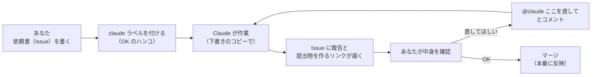

# claude-issue-dev-starter

**GitHub に「依頼書」を書くと、Claude が作業してくれる。** そんな仕組みを、開発をしたことがない人でも自分のプロジェクトに入れられるようにするスターターです。

このリポジトリは **Claude Code のスキル集（プラグイン）** です。`git clone` して Claude Code に読み込ませると、Claude があなたに話しかけながら、設定を一歩ずつ進めてくれます。

---

## これで何ができるの？

会社にたとえると、こんな感じです。

| GitHub での名前 | たとえると |
|---|---|
| リポジトリ | プロジェクトの共有フォルダ |
| Issue（イシュー） | 依頼書 |
| `claude` ラベル | 「この依頼書で作業を始めてOK」のハンコ |
| Claude | 依頼書を読んで作業してくれる新人アシスタント |
| PR（プルリクエスト） | アシスタントの提出物と「確認お願いします」 |
| マージ | 上司が承認して、本番に反映すること |
| CLAUDE.md | アシスタント向けの作業マニュアル |

流れはこうです。



**大事なのは、Claude が勝手に本番を変えないこと。** 最後にハンコを押すのは、いつもあなたです。

---

## 必要なもの

- GitHub のアカウント（無料でOK）
- Claude の有料プラン（Pro / Max / Team / Enterprise）か、Claude Console の API キー
- パソコン（Mac か Windows）と、Claude Code

まだ何も入っていない人は、[準備のしかた](docs/02-prepare.md) を先に見てください。15分くらいで終わります。

---

## はじめかた（3ステップ）

### 1. このスキル集を取り込む

ターミナル（Mac は「ターミナル」、Windows は「PowerShell」）を開いて、次の1行をコピーして貼り付け、Enter を押します。

**Mac**

```bash
git clone https://github.com/Kambara-Michiru/claude-issue-dev-starter.git ~/.claude/skills/issue-dev
```

**Windows（PowerShell）**

```powershell
git clone https://github.com/Kambara-Michiru/claude-issue-dev-starter.git "$HOME\.claude\skills\issue-dev"
```

> `~/.claude/skills/` は、Claude Code が「いつも使うスキル」を探しに行く場所です。ここに置くと、次に Claude Code を起動したときから自動で読み込まれます。

<details>
<summary>別の取り込み方（プラグインとして入れる）</summary>

Claude Code を起動して、入力欄に次の2行を1行ずつ入力します。

```
/plugin marketplace add Kambara-Michiru/claude-issue-dev-starter
/plugin install issue-dev@claude-issue-dev-starter
```

この方法だと、更新も `/plugin` の画面からできます。
</details>

### 2. Claude Code を起動して、セットアップを頼む

作業したいフォルダで Claude Code を起動し、次のように入力します。

```
/issue-dev:setup practice
```

`practice` を付けると、**練習用の新しいリポジトリ**を作るところから始めます。初めての人はこちらがおすすめです。すでにあるプロジェクトに入れたいときは、そのフォルダで `/issue-dev:setup here` と入力します。

あとは Claude の質問に答えていくだけです。全部で7ステップ、30分くらいです。

### 3. 最初の依頼を出してみる

セットアップの最後に、Claude と一緒に最初の依頼書を書きます。数分後、Issue に Claude からの報告が届いたら成功です。

---

## 入っているスキル

| 入力するもの | していること |
|---|---|
| `/issue-dev:setup` | 仕組みをリポジトリに入れる（最初の1回） |
| `/issue-dev:new-issue` | やってほしいことを聞き取って、Claude が作業しやすい依頼書にする |
| `/issue-dev:check` | 作業中の依頼、届いた提出物、うまくいかなかった実行を、わかる言葉で報告する |

セットアップが終わると、あなたのリポジトリに次のファイルが入ります。

```
あなたのリポジトリ/
├── CLAUDE.md                          … Claude への作業マニュアル
└── .github/
    ├── ISSUE_TEMPLATE/claude-task.yml … 依頼書のひな形
    └── workflows/
        ├── claude.yml                 … @claude で呼ぶと返事をする
        ├── claude-review.yml          … 提出物（PR）を自動でチェックする
        └── claude-label.yml           … claude ラベルで作業を始める
```

---

## もっと知りたい人へ

1. [全体像と用語](docs/01-overview.md)：GitHub と Claude が何をしているのか
2. [準備のしかた](docs/02-prepare.md)：アカウント作りとインストール
3. [依頼書（Issue）の書き方](docs/03-writing-issues.md)：うまくいく依頼、いかない依頼
4. [毎日の使い方](docs/04-daily-use.md)：提出物の見方、直してもらい方、カンバン、定期実行
5. [安全と費用](docs/05-safety-and-cost.md)：知っておきたいお金と安全の話
6. [困ったとき](docs/06-troubleshooting.md)：動かないときのチェックリスト

---

## 更新するとき

```bash
git -C ~/.claude/skills/issue-dev pull
```

## 自分用に改造したいとき

このリポジトリを自分のアカウントにコピー（Fork または「Use this template」）して、`skills/` の中の `SKILL.md` を書き換えてください。中身はただの文章なので、プログラミングの知識がなくても編集できます。

## 参考にした公式情報

- [Claude Code GitHub Actions](https://code.claude.com/docs/en/github-actions)
- [anthropics/claude-code-action](https://github.com/anthropics/claude-code-action)
- [Claude Code のスキル](https://code.claude.com/docs/en/skills) / [プラグイン](https://code.claude.com/docs/en/plugins/create)
- [スケジュールタスク（旧 Routines）](https://code.claude.com/docs/en/routines)

仕様は変わることがあります。内容は 2026年11月時点のものです。

## ライセンス

MIT
