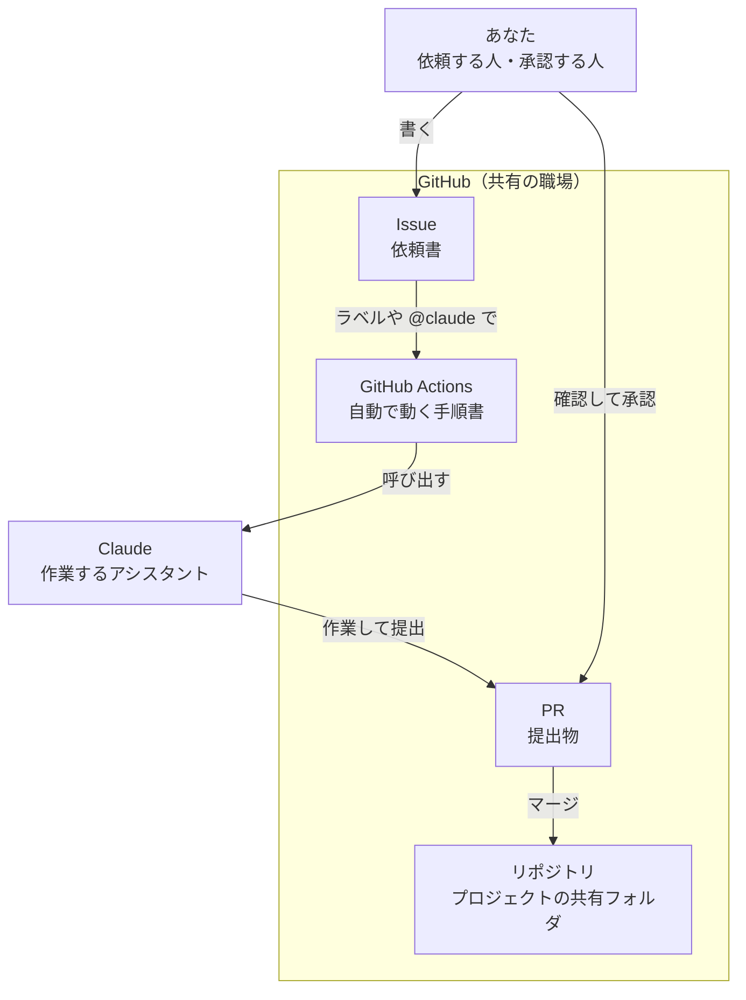

# 1. 全体像と用語

## ひとことで言うと

**GitHub の上に「依頼書を書くと、アシスタントが作業して、あなたが承認する」職場をつくる仕組み**です。

あなたが書くのは日本語の依頼書だけ。プログラムを書くのは Claude です。あなたの仕事は「何をしてほしいかをはっきり書くこと」と「できあがったものを見て OK を出すこと」です。

## 登場人物

## 用語集

| 言葉 | 意味 | たとえ |
|---|---|---|
| **Git（ギット）** | ファイルの変更の歴史を残す道具 | 「いつ、誰が、何を変えたか」が全部残るノート |
| **GitHub（ギットハブ）** | Git の歴史をネット上で共有する場所 | みんなで使う共有の職場 |
| **リポジトリ** | 1つのプロジェクトのファイル一式 | 共有フォルダ |
| **コミット** | 変更を1つの区切りとして記録すること | ノートに「ここまでやった」と書く |
| **ブランチ** | 本番とは別に作業するためのコピー | 下書き用のコピー |
| **main（メイン）** | 本番のブランチ | 清書 |
| **Issue（イシュー）** | やりたいこと・困りごとを書く場所 | 依頼書 |
| **ラベル** | Issue に付ける札 | ハンコや付箋 |
| **PR（プルリクエスト）** | 「この下書きを清書に反映してください」というお願い | 提出物と承認依頼 |
| **マージ** | PR を承認して本番に反映すること | 承認のハンコ |
| **GitHub Actions** | 何かが起きたときに自動で動く仕組み | 「依頼書にハンコが押されたら担当に連絡する」という手順書 |
| **ワークフロー** | GitHub Actions の手順書そのもの（`.github/workflows/` のファイル） | 手順書 |
| **secret（シークレット）** | 鍵（API キーなど）を安全にしまう場所 | 金庫 |
| **CLAUDE.md** | Claude が毎回最初に読むマニュアル | 新人向けの作業マニュアル |
| **CI** | 変更のたびに自動でテストする仕組み | 提出物の自動チェック係 |
| **ターミナル** | 文字で命令を打ち込む画面 | パソコンに話しかける窓口 |
| **Claude Code** | ターミナルなどで動く Claude | あなたの隣に座るアシスタント |

## 2人の Claude がいる

この仕組みでは、Claude が2つの場所で働きます。

1. **あなたのパソコンの Claude（Claude Code）**：このスキル集を読み込んで、設定を手伝ったり、依頼書を一緒に書いたりします
2. **GitHub の上の Claude（GitHub Actions）**：依頼書を読んで、実際の作業をします。あなたのパソコンが閉じていても動きます

## なぜ「依頼書」から始めるの？

- **記録が残る**：何を頼んで、どう直したかが全部残るので、あとから見返せます
- **途中で止められる**：ラベルを付けるまでは動かないので、書きかけで走り出すことがありません
- **チームでも使える**：依頼書はほかの人も読めるので、相談や分担がしやすくなります
- **Claude の得意な形**：目的と完成の条件がはっきりした依頼ほど、Claude は正確に作業できます

次は [準備のしかた](02-prepare.md) へ。
