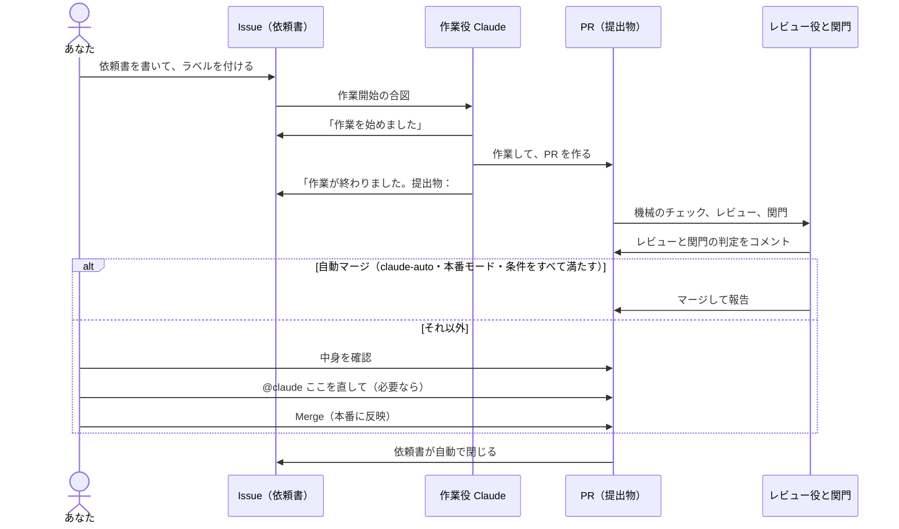

# 4. 毎日の使い方

## ラベルの使い分け

| ラベル | 意味 | 向いている依頼 |
|---|---|---|
| `claude` | 作業して PR まで作る。**マージは自分でする** | ログイン、お金、個人情報にかかわること。大きな変更。自分の目で確かめたいもの |
| `claude-auto` | 作業して、関門の条件をすべて満たしたら**自動でマージしてよい** | 文章の追加、見た目の小さな調整、ドキュメント |
| `hold` | （PR に付ける）この PR は自動マージしない | 「ちょっと待って」と思ったとき |
| `needs-info` | （Claude が付ける）質問に答えてほしい | 答えたら、`claude` か `claude-auto` を付け直す |

迷ったら `claude` にしておけば安心です。

## 基本の流れ



## 提出物（PR）の見方

PR には、2つのコメントが自動で付きます。

- **レビュー役の Claude**：承認したか、危険度（低・中・高）、完成の条件を1つずつ満たしているか、指摘
- **自動マージの関門**：✅ と ❌ の表。❌ が1つでもあれば自動マージされず、あなたの確認待ちになります。❌ の行を読めば、何が理由かわかります

そのうえで、次の4つを見れば判断できます。

1. **Conversation タブ**：Claude が書いた「何を変えたか」「どう確認するか」を読む
2. **Files changed タブ**：変わったところが緑（追加）と赤（削除）で表示されます。全部わからなくて大丈夫。「頼んでいないファイルが変わっていないか」だけ見ます
3. **チェックの結果**：PR の下のほうに ✓（成功）か ✗（失敗）が出ます。✗ のときはマージしないで、`@claude チェックが失敗しているので直して` とコメントします
4. **実際に動かしてみる**：Claude が書いた確認方法の通りに試します。Web ページなら、GitHub Pages や手元で開いて見てみます

## 直してもらうとき

PR のコメント欄に `@claude` を付けて書きます。

```
@claude 文章が少し硬いので、もう少しやわらかい言葉にして
@claude スマホで見ると画像がはみ出しているので直して
@claude 2つ目の完成の条件がまだできていないみたいです
```

特定の行について言いたいときは、「Files changed」タブでその行の横の **+** を押してコメントできます。

Claude が直して push すると、機械のチェック、レビュー、関門がもう一度動きます。

機械のチェックが2回とも通らなかったときは、PR が**下書き（Draft）**で作られます。`@claude チェックが通るように直して` とコメントし、通ったら「Ready for review」を押してください。

## マージのしかた

1. PR の下のほうにある緑の **Merge pull request**（または **Squash and merge**）を押す
2. **Confirm merge** を押す
3. 「Delete branch」と出たら押してOK（下書きのコピーを片付けるだけです）

PR の本文に `Closes #番号` があるので、マージすると依頼書（Issue）も自動で閉じます。

## 自動マージを本番にする

最初は**練習モード**です。関門は「本番なら自動マージされていました」とコメントするだけで、マージはあなたがします。

何回か（目安は 10 件くらい）試して、次のように思えたら本番に切り替えます。

- 関門が ✅ にしたものは、自分で見ても問題なかった
- ❌ になった理由に納得できた

切り替えは、Claude Code で `/issue-dev:automerge on` と入力します。これまでの判定の記録を見せてくれて、設定を変える PR を作ってくれます。その PR をあなたがマージした時点から本番になります。

止めたいときは：

- 1つの PR だけ：その PR に `hold` ラベルを付ける
- 全部：`/issue-dev:automerge off`

自動でマージされたものに問題があったら、その PR の画面にある **Revert** ボタンで元に戻せます。

## 週1回の「ハーネス点検」

毎週月曜の朝に、「🧰 今週のハーネス点検」という Issue が届きます。この1週間の判定や指摘から、Claude が改善を提案します。

- 📘 **指示書**：CLAUDE.md や `docs/agent/` に足すとよいこと
- 🔬 **機械のチェック**：`scripts/check.local.sh` に足すとよいチェック
- 🚦 **自動マージのルール**：条件の見直し

よいと思うものがあれば、その Issue に `@claude 提案1と3を反映して` とコメントします。仕組みのファイルを変える PR になるので、マージはあなたがします（関門は自動マージしません）。

**同じ失敗が2回起きたら、Claude を責めるより、指示書かチェックを1行足す。** これがハーネスを育てるコツです。

## カンバン（GitHub Projects）で管理する

依頼書が増えてきたら、GitHub Projects でカンバンボードにすると見やすくなります。

1. リポジトリの **Projects** タブ →「New project」→「Board」を選ぶ
2. 列を「Todo」「Claude 作業中」「確認待ち」「Done」にする
3. Project の右上の「…」→ **Workflows** で、次を ON にする
   - Item added to project → **Todo**
   - Pull request linked to issue → **確認待ち**（列名は自由）
   - Item closed / Pull request merged → **Done**
4. 依頼書に `claude` か `claude-auto` ラベルを付けたら「Claude 作業中」に動かす

優先順位や締め切りは人間が決め、Claude には作業だけを任せると、役割がはっきりします。

## 慣れてきたら：定期的に任せる（スケジュールタスク）

Claude の有料プランなら、**スケジュールタスク**（以前は Routines という名前でした）で、決まった時間や GitHub の出来事をきっかけに Claude を動かせます。あなたのパソコンが閉じていても、クラウドで動きます。

作り方は2つあります。

- ブラウザで https://claude.ai/code/routines を開く
- Claude Code で `/schedule` と入力し、やりたいことを話す（例：`/schedule 毎朝9時に、ready ラベルの付いた Issue を1つ選んで作業して`）

使い方の例：

- 毎朝、`ready` ラベルの依頼書を1件ずつ片付ける
- PR がマージされたら、お知らせ（CHANGELOG）を更新する
- 毎週、古くなった依頼書をまとめて報告する

注意点：

- スケジュールタスクは **あなた個人の claude.ai アカウント** に属し、チームとは共有されません
- スケジュールタスクが作るコミットや PR は **あなたの GitHub ユーザー** として記録されます
- 1時間に1回より短い間隔では動かせません

まずは、ラベルで頼む基本の流れに慣れてから試すのがおすすめです。

次は [安全と費用](05-safety-and-cost.md) へ。
