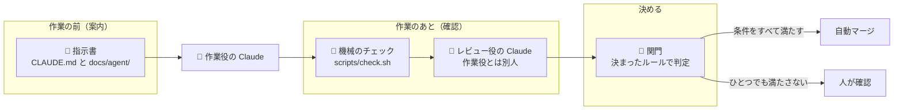
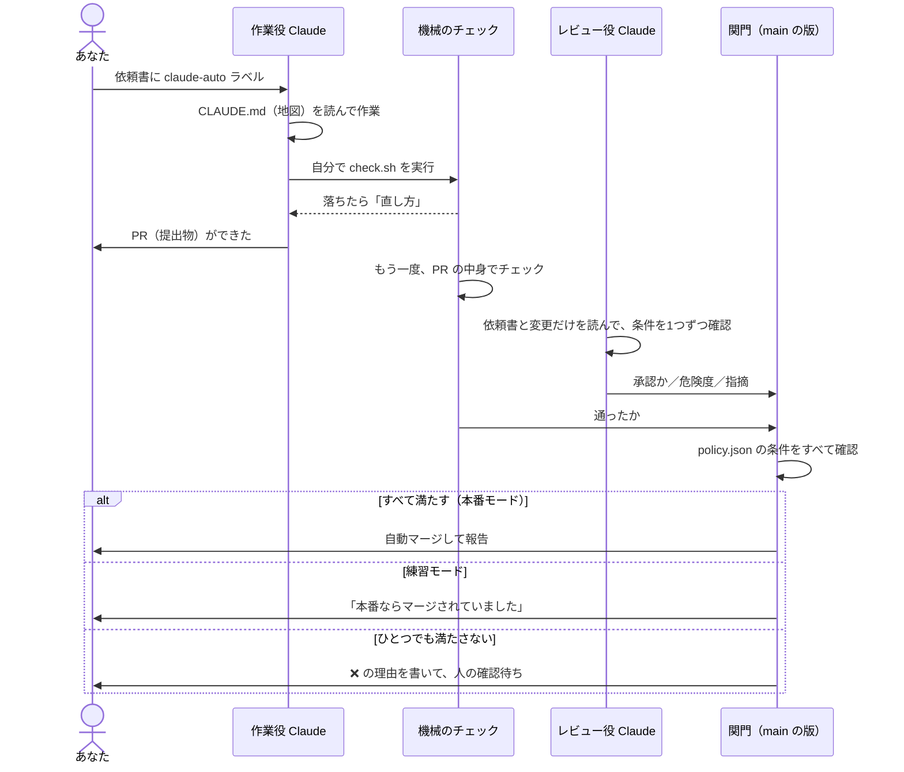

# 7. ハーネスと自動マージのしくみ

## ハーネスってなに？

馬に付ける「手綱（たづな）」や、高いところで作業する人の「安全ベルト」のことです。

2026年、AI に開発を任せるときの考え方として **「ハーネスエンジニアリング」** という言葉が広まりました。ひとことで言うと、

> **AI エージェント ＝ モデル（AI の頭脳）＋ ハーネス（それ以外のすべて）**

AI がうまく働くかどうかは、頭脳の賢さだけでなく、**まわりに用意した指示書・チェック・関門の出来**で大きく変わる、という考え方です。AI が失敗したとき「次の賢い AI を待とう」ではなく、**「同じ失敗が起きないように、ハーネスを直そう」**と考えます。

このスターターは、その考え方を、開発の経験がなくても使える形にしたものです。

## ハーネスの4つの部品

| 部品 | 役割 | このスターターでは |
|---|---|---|
| 📘 **指示書**（ガイド） | 作業の前に、進め方や守ることを伝える | `CLAUDE.md`（短い地図）と `docs/agent/`（くわしい資料） |
| 🔬 **機械のチェック**（センサー） | 作業のあとに、機械で確かめられることを毎回確かめる | `scripts/check.sh`。失敗したら「直し方」まで表示する |
| 🧐 **レビュー役**（もう一つのセンサー） | 機械では確かめにくいこと（依頼どおりか、危なくないか）を、別の目で確かめる | 作業役とは別の Claude が、まっさらな状態で読む |
| 🚦 **関門**（ゲート） | マージしてよいかを、決まったルールで判定する | `.github/harness/policy.json` と `gate.py` |

## なぜこの形なのか（2026年の考え方）

### 1. 指示書は「百科事典」ではなく「地図」にする

長い指示書は読み飛ばされ、古くなっても気づかれません。そこで CLAUDE.md は**短い地図**にして、くわしい内容は別のファイルに置き、どこに何があるかだけを書きます。OpenAI のチームは、約100行の AGENTS.md を「目次」として使い、知識は docs/ に置くやり方を紹介しています。

→ このスターターでは、CLAUDE.md が 150 行を超えると、機械のチェックで落ちるようにしています。

### 2. 「書いたルール」と「確かめるしくみ」をセットにする

ルールを書くだけでは、守られたかわかりません。チェックだけでは、同じ失敗をくり返します。**案内（指示書）と確認（チェック）をセットにする**のが基本です。

さらに、チェックが失敗したときは **「どう直せばいいか」まで表示する**と、AI が自分で直せるようになります。

→ `scripts/check.sh` はすべての失敗に「→ 直し方」を表示します。作業役の Claude は、作業の最後に自分でこれを実行し、落ちたら直します。それでも落ちたら、結果を見せてもう1回だけ直させます。

### 3. 機械で確かめられることは、AI に判断させない

確かめ方には2種類あります。

- **機械のチェック**：速い・安い・毎回同じ結果（鍵が書かれていないか、ファイルが壊れていないか、テストが通るか）
- **AI の判断**：遅い・高い・毎回少し違う。でも「依頼どおりか」「危なくないか」がわかる

機械で確かめられることは機械に任せ、AI の判断は、機械では無理なところにだけ使います。

### 4. 作った本人に採点させない

AI は、自分が作ったものを評価させると、出来がいまひとつでも自信をもって褒めてしまう傾向があります。Anthropic は、作る役とは別に「評価役」のエージェントを置くことで、この問題に対処しています。

→ このスターターでは、レビュー役の Claude は、作業役の会話を見ずに、まっさらな状態で依頼書と変更だけを読みます。作業役の「できました」という自己申告は信じず、完成の条件を1つずつ自分で確かめます。

### 5. マージを決めるのは、AI ではなく決まったルール

AI のレビューは速くて便利ですが、確率で動くものです。「マージしてよいか」という最後の決定は、**毎回同じ答えを出す決まったルール**に任せるのが安全です。

→ 関門（`gate.py`）は AI ではありません。次の条件を**すべて**満たしたときだけ自動マージします。

| 条件 | 理由 |
|---|---|
| `claude-auto` ラベルが付いていて、`hold` が付いていない | 人が「任せてよい」と決めたものだけ |
| 依頼書を書いたのがメンバー | 知らない人の依頼は自動で通さない |
| 機械のチェックがすべて通った | 決まったことは確実に |
| レビュー役が承認し、危険度が「低」、重大な指摘なし | 意味のチェック |
| 完成の条件をすべて満たしている | 依頼どおりか |
| 変更が 10 ファイル以下・300 行以下 | 失敗したときの影響を小さく |
| 守るべきファイル（仕組みそのもの、鍵、設定）に触れていない | 関門を自分でゆるめられないように |
| チェックのあとで中身が変わっていない | 古い確認で新しい変更を通さない |

**「AI の自信」ではなく「影響範囲」で決める**のがポイントです。

### 6. 関門は、提出物の中から書き換えられない場所に置く

もし PR の中で関門のルールを書き換えられたら、意味がありません。

→ 関門のワークフローは、**いつも main ブランチの版**で動きます。PR の中で `policy.json` や `gate.py` を書き換えても、その PR の判定には使われません。しかも、それらに触れた PR は「守るべきファイルに触れた」として自動マージされません。

### 7. 少しずつ任せる

いきなり全部を任せるのではなく、段階を踏みます。Vercel は自動マージを入れるとき、まず判定だけを黙って記録し、次に判定を表示し、最後に実際に使う、という3段階で進めました。

→ このスターターも同じです。

| モード | すること |
|---|---|
| `shadow`（練習、最初はこれ） | 判定して「本番なら自動マージされていました」とコメントするだけ。マージは人 |
| `on`（本番） | 条件をすべて満たしたら自動でマージする |
| `off` | 自動マージしない |

練習モードで判定を見て、「自分の判断と合っている」と思えたら `/issue-dev:automerge on` で本番にします。

### 8. 失敗をハーネスに還す

同じ失敗が起きたら、指示書やチェックを直して、次からは起きにくく（できれば起きないように）します。

→ 毎週月曜に「ハーネス点検」の Issue が届きます。1週間の判定や指摘から、Claude が「指示書に足すこと」「機械のチェックに足すこと」「ルールの見直し」を提案します。採用するかどうかは人が決めます。

## 全体の流れ（くわしい版）

## もっと知りたい人へ（参考にした記事）

- Birgitta Böckeler「[Harness engineering for coding agent users](https://martinfowler.com/articles/harness-engineering.html)」（martinfowler.com、2026年4月）：案内（guides）と確認（sensors）、機械のチェックと AI の判断の使い分け
- OpenAI「[Harness engineering: leveraging Codex in an agent-first world](https://openai.com/index/harness-engineering/)」（2026年2月）：AGENTS.md を目次にし、知識を docs/ に置く
- Anthropic「[Effective harnesses for long-running agents](https://www.anthropic.com/engineering/effective-harnesses-for-long-running-agents)」、「[Harness design for long-running application development](https://www.anthropic.com/engineering/harness-design-long-running-apps)」：作る役と評価役を分ける
- Vercel「[58% of PRs in our largest monorepo merge without human review](https://vercel.com/blog/58-percent-of-prs-in-our-largest-monorepo-merge-without-human-review)」（2026年4月）：危険度で分けた自動マージと、3段階での導入
- Addy Osmani「[Agent Harness Engineering](https://addyosmani.com/blog/agent-harness-engineering/)」（2026年4月）：失敗したら、モデルではなくハーネスを直す
